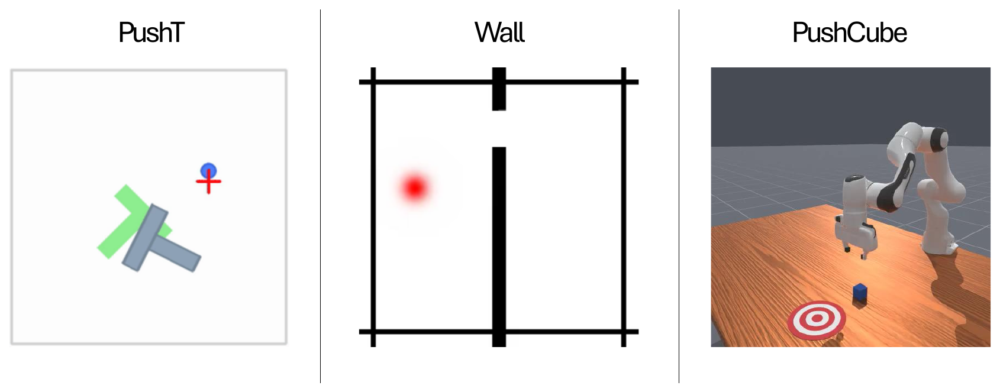
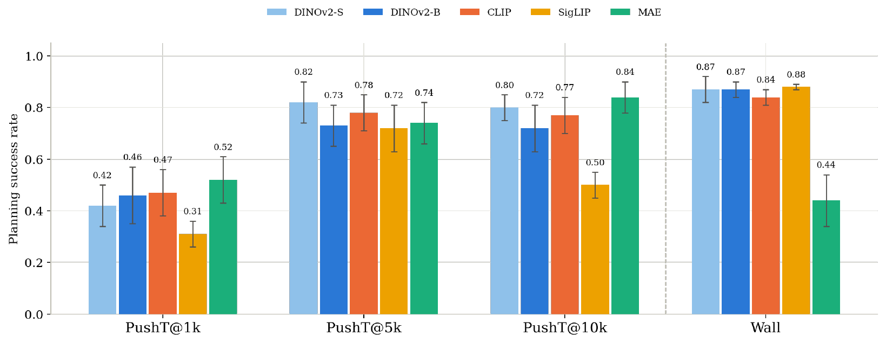
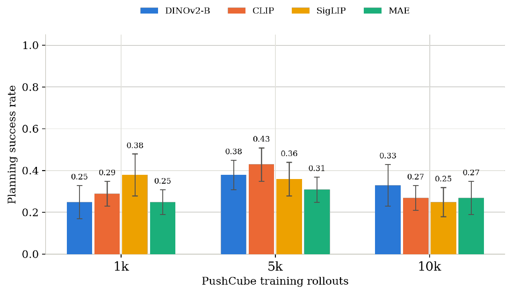

# Does the Visual Backbone Matter? Pretraining Paradigms in DINO-WM

A controlled comparison of frozen visual encoders (DINOv2, CLIP, SigLIP, MAE) inside
[DINO-WM](https://github.com/gaoyuezhou/dino_wm) (Zhou et al., 2024), a world model that predicts
future patch features and plans directly in feature space.

DINO-WM uses DINOv2 by default, and most follow-up work keeps it. We swap only the encoder and keep
the predictor, the planner, the data and the training budget fixed, then measure planning success on
two 2D tasks (PushT, Wall) and on a 3D pushing task we added (PushCube, built on ManiSkill3).

Course project for Computer Vision and Cognitive Systems, Università degli Studi di Modena e Reggio
Emilia. Full write-up: [report](dino_wm/docs/report.pdf), [appendix with all per-seed values](dino_wm/docs/supplementary.pdf),
[slides](dino_wm/docs/presentazione.pdf).

## Main findings

1. **Most backbones work well, but the best one depends on the task.** On PushT all backbones
   are close: at 5k rollouts all five lie between 0.72 and 0.82, within about one seed standard
   deviation of each other. The one large gap in the study is MAE on Wall (0.44, against
   0.84-0.88 for the others), although MAE is competitive on PushT. No single ranking
   holds across tasks.
2. **On the 3D task the differences mostly disappear.** On PushCube no backbone exceeds 0.43 and
   the gaps between the four are within one to two seed standard deviations at every dataset size.
3. **A lower one-step prediction loss did not guarantee better planning.** Going from 5k to 10k rollouts
   lowers the validation loss for every backbone, yet planning success drops sharply for SigLIP
   on PushT (0.72 → 0.50) and by about 9 points on average on PushCube. We ruled out several
   causes but could not identify the real one; see
   [The 5k → 10k drop](#the-5k--10k-drop-an-open-question).

## Method

<p align="center"></p>

The encoder is frozen and turns each frame into a 14×14 grid of patch features, the frame's latent
state. A ViT predictor, trained from scratch, predicts the next latent state from a history of
past latent states (the last three frames), the actions and the proprioceptive state. At test time
a planner (MPC with the Cross-Entropy Method) searches for the action sequence whose predicted
final features are closest to the features of a goal image.
No pixels are decoded during planning.

Only the encoder changes between experiments:

| Backbone | Pretraining objective | Checkpoint | Encoder params (frozen) | Predictor params (trained) |
|---|---|---|---|---|
| DINOv2-S | self-distillation | `dinov2_vits14` | ~21M | 20.1M |
| DINOv2-B | self-distillation | `dinov2_vitb14` | ~86M | 39.2M |
| CLIP | image-text contrastive (softmax) | `openai/clip-vit-base-patch16` | ~86M | 39.2M |
| SigLIP | image-text contrastive (sigmoid) | `google/siglip-base-patch16-224` | ~93M | 39.2M |
| MAE | masked image modeling | `facebook/vit-mae-base` | ~86M | 39.2M |

DINOv2-S is DINO-WM's original encoder and is kept as a reference on PushT and Wall. DINOv2-B is
the size-matched comparison against the other three. Smaller CLIP- and MAE-style models exist
(TinyCLIP, MobileCLIP, MAE-Lite), but they differ in training recipe, dataset or architecture, so
we compare backbones at Base scale.

Every backbone provides a full 14×14 grid of patch tokens from its last layer, without the CLS
token. DINOv2 uses `x_norm_patchtokens`; CLIP, SigLIP and MAE use Hugging Face's
`last_hidden_state`, which for CLIP is not passed through a final LayerNorm. MAE runs with masking
disabled (`mask_ratio=0`) and a fixed patch order, obtained by passing a constant `noise` input
(`torch.arange`) instead of the default random one. Frames are resized to 196×196 for DINOv2
(patch size 14) and kept at 224×224 for the others (patch size 16).

## Tasks

<p align="center"></p>

| Task | Description | Training data | Success criterion |
|---|---|---|---|
| PushT | push a T-shaped block to a target pose (2D) | 1k / 5k / 10k rollouts, nested subsets of the DINO-WM dataset | agent and block within 20 px of the goal state, block angle within 20° |
| Wall | navigate a dot through a door in a wall (2D) | 1920 rollouts (the full released dataset) | agent within 4.5 units of the goal position |
| PushCube | push a cube into a target region with a Franka arm (3D, ManiSkill3 `PushCube-v1`) | 1k / 5k / 10k rollouts, generated by us | cube within 10 cm of the centre of the goal region |

What each task gives the model and what it has to read from the image:

| Task | Simulator state (used only for success and diagnostics) | Proprioception (fed to the model) | Action | Visible only in the image |
|---|---|---|---|---|
| PushT | 5-dim: agent xy, block xy, block angle | 4-dim: agent xy + velocity | 2-dim: relative agent displacement | block position and orientation |
| Wall | 2-dim: dot xy | 2-dim: dot xy | 2-dim: dot displacement | wall and door position, which change between episodes |
| PushCube | 9-dim: end-effector xyz, cube xyz, goal xyz | 6-dim: end-effector xyz + velocity | 4-dim: end-effector xyz delta + gripper (always closed) | cube and goal position, in 3D |

The world model never receives the object state directly: on every task, the object to be moved
(or, on Wall, the obstacle) is known to the model only through the encoder's patch features.

PushCube is our extension. Training rollouts replay ManiSkill3's motion-planning demonstrations
with Gaussian action noise (σ = 0.05). Planning goals come from a 50-episode validation set
(different episodes, same scene layouts as training) in which the cube is verified to be inside
the goal region at the goal frame.

## Experimental protocol

**Training.** Identical for every backbone: 20 epochs, batch size 32, AdamW with a constant
learning rate of 5e-4, frozen encoder, no decoder loss. One predictor is trained per
(backbone, task, dataset size). The original paper trains for 100 epochs; 20 was what our compute
allowed.

**Planning.**

| | PushT | Wall | PushCube |
|---|---|---|---|
| Goal horizon (model steps, frameskip 5) | 5 | 5 | 15 |
| CEM samples / elites / optimisation steps | 300 / 30 / 30 | 300 / 30 / 10 | 100 / 25 / 15 |
| Max MPC iterations | 10 | 10 | 10 |
| Episodes per seed | 50 | 50 | 30 |
| Planning seeds | 5 (99, 42, 123, 456, 789) | 5 (same) | 5 (same) |

These are the defaults in `conf/plan_pusht.yaml`, `conf/plan_wall.yaml` and `conf/plan_pushcube.yaml`.

Patch features receive no additional normalisation, so their scale differs between backbones. This
affects the planning cost and the relative weight of its visual and proprioceptive terms, which are
combined with a fixed weight.

All numbers below are mean ± standard deviation over the five planning seeds. The seeds change
the sampled evaluation episodes and the CEM noise; they do **not** retrain the predictor.

## Results

### PushT and Wall

<p align="center"></p>

| Backbone | PushT@1k | PushT@5k | PushT@10k | Wall |
|---|---|---|---|---|
| DINOv2-S | 0.42 ± 0.08 | **0.82 ± 0.08** | 0.80 ± 0.05 | 0.87 ± 0.05 |
| DINOv2-B | 0.46 ± 0.11 | 0.73 ± 0.08 | 0.72 ± 0.09 | 0.87 ± 0.03 |
| CLIP | 0.47 ± 0.09 | 0.78 ± 0.07 | 0.77 ± 0.07 | 0.84 ± 0.03 |
| SigLIP | 0.31 ± 0.05 | 0.72 ± 0.09 | 0.50 ± 0.05 | **0.88 ± 0.01** |
| MAE | **0.52 ± 0.09** | 0.74 ± 0.08 | **0.84 ± 0.06** | 0.44 ± 0.10 |

- **On PushT the backbones are largely interchangeable.** Most gaps are within one or two seed
  standard deviations. MAE has the highest mean at 1k and 10k, but its lead over DINOv2-S and CLIP
  is not significant. The clear outlier is SigLIP, lowest at 1k and 10k.
- **On Wall, MAE is the exception.** It is the only backbone that fails: every MAE seed
  (0.32-0.52) is below every seed of the other four (0.80-0.94), which are within 0.04 of each
  other on average. One possible explanation is that PushT rewards precise spatial placement,
  which a pixel-reconstruction objective preserves, while Wall rewards a coarser distinction
  (which side of the wall the agent is on), where MAE's features may be weaker. SigLIP is the
  mirror case: weakest on PushT, tied for best on Wall.
- **More data helps up to 5k.** Every backbone improves from 1k to 5k on PushT. From 5k to 10k
  DINOv2 and CLIP are flat, MAE keeps improving and SigLIP drops.

### PushCube

<p align="center"></p>

| Backbone | 1k | 5k | 10k |
|---|---|---|---|
| DINOv2-B | 0.25 ± 0.08 | 0.38 ± 0.07 | **0.33 ± 0.10** |
| CLIP | 0.29 ± 0.06 | **0.43 ± 0.08** | 0.27 ± 0.06 |
| SigLIP | **0.38 ± 0.10** | 0.36 ± 0.08 | 0.25 ± 0.07 |
| MAE | 0.25 ± 0.06 | 0.31 ± 0.06 | 0.27 ± 0.08 |

- **The task is hard for every backbone.** The best result is 0.43, against 0.84-0.88 on the 2D
  tasks. Possible factors include the 3D setting, which none of the four pretraining objectives
  targets, and the reduced CEM budget we use on PushCube.
- **The backbones are not separable.** The gaps between them are one to two seed standard
  deviations.
- **CLIP and MAE seem to match the arm better than the cube.** For these backbones at 5k and 10k
  rollouts, `mean_proprio_dist` is low. This metric is not the Euclidean distance between the
  end-effector and its goal position: it is the mean absolute error over the proprioceptive
  components (xyz position and velocity), so lower values simply indicate a closer match.
  `mean_state_dist` is instead a Euclidean distance over the end-effector, cube and goal positions.
  Since the goal is fixed and the proprioceptive error is small, most of it most likely comes from
  the cube. For SigLIP and DINOv2-B at the same dataset sizes, the proprioceptive error is larger,
  so this attribution does not hold. One possible reason for the difference between arm and cube
  is that the arm covers many patches and also enters the planning cost through proprioception,
  while the cube covers only a few. Success only requires the cube to end inside the target
  region, so a similar error can mean success or failure, depending on its direction and on how
  close to the centre the cube was in the goal image.

<p align="center"></p>

A failed PushCube episode for each backbone: the real final frame (top row) and the world
model's imagined final frame decoded to pixels (bottom row). DINOv2, CLIP and SigLIP decode to a
recognisable arm; MAE decodes to noise. The decoder was trained separately, after all planning
results, and is used only for this visualisation.

## The 5k → 10k drop: an open question

Doubling the training data from 5k to 10k rollouts lowers planning success in two places.

**What we observe**

- **SigLIP on PushT:** 0.72 → 0.50, in all five seeds.
- **PushCube, all four backbones:** CLIP −0.16, SigLIP −0.11, DINOv2-B −0.05, MAE −0.04. Averaged
  over backbones the drop is negative in all five seeds (mean −0.09). Taken alone, only CLIP's
  drop is clearly outside seed noise. These comparisons capture planning variability only, since
  each configuration has a single trained predictor.
- **PushT, other backbones:** no drop (DINOv2 and CLIP flat, MAE +0.10).

**What we verified**

The validation set is the same for every dataset size of a task (50 episodes on PushCube, 21 on
PushT), so validation losses are comparable across 1k, 5k and 10k within one backbone.

- **The world model does not overfit its training distribution.** No run shows the validation loss
  rising: at epoch 20 it is within 1.6% of its minimum, and flat or still slightly decreasing over
  the last five epochs.
- **More data gives a better predictor.** Validation loss decreases monotonically with dataset size
  (1k > 5k > 10k) for every backbone on both tasks.
- **The 10k runs are not under-trained.** At epoch 10 they have taken as many gradient steps as
  the 5k runs at epoch 20 and already reach a lower validation loss, and their curves are flat by
  epoch 20.
- **The other planning metrics do not explain it.** Besides success we log, at the end of each
  episode, the state, proprioceptive and pixel distances to the goal and the gap between imagined
  and real final features (see the [appendix](dino_wm/docs/supplementary.pdf)). From 5k
  to 10k they move in different directions for different backbones, with no consistent relation
  to the change in success.

The 10k predictor is therefore the most accurate one on the data it is evaluated on, but not the
best planner.

**The role of the PushCube dataset**

Our PushCube data has a specific structure. Every training rollout replays one of 997 ManiSkill3
motion-planning demonstrations with fresh action noise, so beyond 1k rollouts no new scene layouts
are added: 5k and 10k contain about 5 and 10 noisy replays of the same 997 expert trajectories. The
validation episodes are also replays of demonstrations that appear in training. The validation
loss therefore measures how well the model fits expert-like trajectories on known layouts, not how
it behaves on the off-distribution action sequences that CEM samples. A predictor that specialises
further on these trajectories, for example by relying more on the visual context and less on the
action input, would look better on validation and plan worse. This is a case of **objective
mismatch**: the world model is trained to minimise one-step prediction error, but it is used for
planning, and a lower prediction error does not guarantee better plans.

This cannot be the whole explanation, though. The same kind of drop appears on PushT (SigLIP,
0.72 → 0.50), whose dataset comes from DINO-WM and contains 18,685 distinct episodes. Whatever
causes the drop is not specific to how we generated PushCube.

**What remains open**

Objective mismatch explains how planning can get worse while the loss improves, but not why 10k
is worse than 5k. The two objectives differ in concrete ways: the loss is a one-step error
averaged over all 196 patches, while planning relies on multi-step rollouts on CEM's action
sequences and on ranking the candidates correctly, which depends on the few patches the object
occupies. None of our metrics measures this directly. With one training run per configuration we
also cannot separate an effect of the additional data from variability between training runs and
between checkpoints.

**Experiments that would identify the cause**

| Experiment | Cost | What it tells |
|---|---|---|
| Plan with intermediate checkpoints of the 10k runs (epoch 10, same gradient steps as 5k at epoch 20; epochs 15–19) | planning only | whether the drop is checkpoint noise or a property of the 10k model |
| Retrain the affected 5k and 10k cells with different training seeds | 2 trainings per cell | variance between training runs, which our standard deviations do not include |
| Validation loss with the true actions vs actions shuffled across episodes, 5k vs 10k | inference only | whether the 10k model relies less on the action input |
| Validation with higher action noise (σ = 0.15–0.2) and, on PushCube, with layouts not among the 997 demonstrations | data generation + inference | whether the 10k model generalises worse outside the training trajectories |

## Repository layout

```
dino_wm/
  train.py, plan.py           training and planning entry points (from DINO-WM, modified)
  conf/                       Hydra configs; conf/encoder/{dino,dino_base,clip,siglip,mae}.yaml
  models/hf_encoders.py       CLIP, SigLIP and MAE encoder wrappers
  env/pushcube/               ManiSkill3 PushCube wrapper with the PushT/Wall interface
  datasets/pushcube_dset.py   PushCube dataset loader
  scripts/                    PushCube dataset generation
  docs/                       report.pdf, supplementary.pdf, presentazione.pdf
```

## Reproducing

Environment setup and the PushT and Wall datasets follow the
[upstream instructions](dino_wm/README.md), with newer packages than those pinned there. Our runs
used `torch` 2.5.1, `transformers` 4.57.6, `accelerate` 1.14.0, `safetensors` 0.8.0 and `gym`
0.26.2. PushCube additionally used `mani_skill` 3.0.1, `sapien` 3.0.3 and `gymnasium` 1.3.0, and
needs the `PushCube-v1` motion-planning demonstrations converted to the `pd_ee_delta_pos` control
mode.

Run the commands below from `dino_wm/`, with `DATASET_DIR` pointing at the data folder:

```bash
export DATASET_DIR=$PWD/data
```

Generate the PushCube dataset:

```bash
python scripts/generate_pushcube_dataset.py --demo-path <demos.h5> --out-dir data/pushcube_noise --num-train-rollouts 10000 --num-val-rollouts 50 --max-steps 150 --action-noise-std 0.05
```

Regenerating the dataset gives comparable but not identical episodes; the reported validation set
was produced with an earlier version of the script.

Train a predictor:

```bash
python train.py --config-name train.yaml env=pushcube encoder=clip frameskip=5 num_hist=3 env.dataset.n_rollout=5000 training.batch_size=32 training.epochs=20 hydra.run.dir=outputs/pushcube_clip_5000
```

Plan with the trained predictor:

```bash
python plan.py --config-name plan_pushcube.yaml ckpt_base_path=$PWD model_name=pushcube_clip_5000 model_epoch=20 seed=99
```

## Changes relative to upstream DINO-WM

- CLIP, SigLIP, MAE and DINOv2-Base encoders.
- PushCube task: environment wrapper, dataset loader, dataset generation and validation-set
  scripts.
- Fixes to training resume and to decoder loading at planning time.

## Authors

Giulia Moretti and Rocco Lubino.

## Acknowledgements

This project builds on [DINO-WM](https://github.com/gaoyuezhou/dino_wm) by Gaoyue Zhou, Hengkai
Pan, Yann LeCun and Lerrel Pinto, and its PushCube task uses
[ManiSkill3](https://github.com/haosulab/ManiSkill).

**References**

- Zhou, G., Pan, H., LeCun, Y., & Pinto, L. (2024). *DINO-WM: World Models on Pre-trained Visual
  Features enable Zero-shot Planning*. arXiv:2411.04983. [arXiv](https://arxiv.org/abs/2411.04983)
- Oquab, M., Darcet, T., Moutakanni, T., et al. (2023). *DINOv2: Learning Robust Visual Features
  without Supervision*. arXiv:2304.07193. [arXiv](https://arxiv.org/abs/2304.07193)
- Radford, A., Kim, J. W., Hallacy, C., et al. (2021). *Learning Transferable Visual Models From
  Natural Language Supervision*. ICML 2021. [arXiv](https://arxiv.org/abs/2103.00020)
- Zhai, X., Mustafa, B., Kolesnikov, A., & Beyer, L. (2023). *Sigmoid Loss for Language Image
  Pre-Training*. ICCV 2023. [arXiv](https://arxiv.org/abs/2303.15343)
- He, K., Chen, X., Xie, S., Li, Y., Dollár, P., & Girshick, R. (2022). *Masked Autoencoders Are
  Scalable Vision Learners*. CVPR 2022. [arXiv](https://arxiv.org/abs/2111.06377)
- Tao, S., Xiang, F., Shukla, A., et al. (2024). *Demonstrating GPU Parallelized Robot Simulation
  and Rendering for Generalizable Embodied AI with ManiSkill3*. arXiv:2410.00425. [arXiv](https://arxiv.org/abs/2410.00425)
- Vasu, P. K. A., Pouransari, H., Faghri, F., Vemulapalli, R., & Tuzel, O. (2024). *MobileCLIP:
  Fast Image-Text Models through Multi-Modal Reinforced Training*. CVPR 2024. [arXiv](https://arxiv.org/abs/2311.17049)
- Wang, S., Gao, J., Li, Z., Zhang, X., & Hu, W. (2023). *A Closer Look at Self-Supervised
  Lightweight Vision Transformers*. ICML 2023. [arXiv](https://arxiv.org/abs/2205.14443)
- Wu, K., Peng, H., Zhou, Z., et al. (2023). *TinyCLIP: CLIP Distillation via Affinity Mimicking
  and Weight Inheritance*. ICCV 2023. [arXiv](https://arxiv.org/abs/2309.12314)

## License

Released under the MIT license; see [LICENSE](LICENSE) and [dino_wm/LICENSE](dino_wm/LICENSE).
