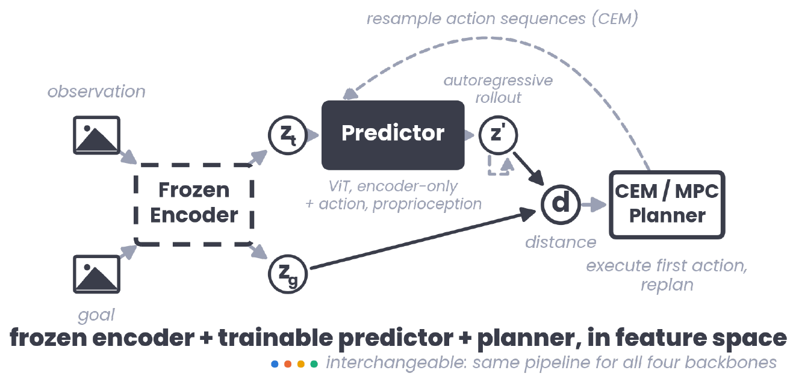
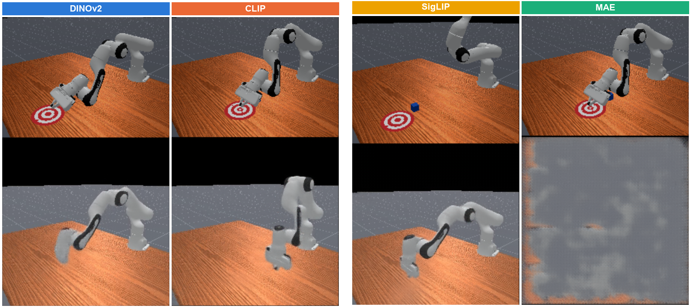

# Does the Visual Backbone Matter? Pretraining Paradigms in DINO-WM

A controlled comparison of frozen visual encoders (DINOv2, CLIP, SigLIP, MAE) inside
[DINO-WM](https://github.com/gaoyuezhou/dino_wm) (Zhou et al., 2024), a world model that predicts
future patch features and plans directly in feature space.

DINO-WM uses DINOv2 by default, and most follow-up work keeps it. We swap only the encoder and keep
the predictor, the planner, the data and the training budget fixed, then measure planning success on
two 2D tasks (PushT, Wall) and on a 3D pushing task we added (PushCube, built on ManiSkill3).

Course project for Computer Vision and Cognitive Systems, Università degli Studi di Modena e Reggio
Emilia. Full write-up: [report](dino_wm/papers_things/report.pdf), [appendix with all per-seed values](dino_wm/papers_things/supplementary.pdf),
[slides](dino_wm/papers_things/presentazione.pdf).

## Main findings

1. **The best backbone depends on the task.** MAE is the best encoder on PushT at 10k rollouts
   (0.84) and by far the worst on Wall (0.44, against 0.84-0.88 for the others). No single ranking
   holds across tasks.
2. **On the 3D task the differences mostly disappear.** On PushCube no backbone exceeds 0.43 and
   the gaps between the four are within one to two seed standard deviations at every dataset size.
3. **One-step prediction loss does not predict planning success.** Going from 5k to 10k rollouts
   lowers the validation loss for every backbone, yet planning success drops sharply for SigLIP
   on PushT (0.72 → 0.50) and by about 9 points on average on PushCube. We ruled out several
   causes but could not identify the real one; see
   [The 5k → 10k drop](#the-5k--10k-drop-an-open-question).

## Method

<p align="center"></p>

The encoder is frozen and turns each frame into a 14×14 grid of patch features. A ViT predictor,
trained from scratch, predicts the next frame's features from the previous three frames, the action
and the proprioceptive state. At test time a planner (MPC with the Cross-Entropy Method) searches
for the action sequence whose predicted final features are closest to the features of a goal image.
No pixels are decoded during planning.

Only the encoder changes between experiments:

| Backbone | Pretraining objective | Checkpoint | Encoder params (frozen) | Predictor params (trained) |
|---|---|---|---|---|
| DINOv2-S | self-distillation | `dinov2_vits14` | ~21M | 20.1M |
| DINOv2-B | self-distillation | `dinov2_vitb14` | ~86M | 39.2M |
| CLIP | image-text contrastive (softmax) | `openai/clip-vit-base-patch16` | ~86M | 39.2M |
| SigLIP | image-text contrastive (sigmoid) | `google/siglip-base-patch16-224` | ~93M | 39.2M |
| MAE | masked image modeling | `facebook/vit-mae-base` | ~86M | 39.2M |

DINOv2-S is DINO-WM's original encoder and is kept as a reference on PushT and Wall. DINOv2-B is
the size-matched comparison against the other three.

## Tasks

<p align="center"></p>

| Task | Description | Training data | Success criterion |
|---|---|---|---|
| PushT | push a T-shaped block to a target pose (2D) | 1k / 5k / 10k rollouts, nested subsets of the DINO-WM dataset | agent and block within 20 px of the goal state, block angle within 20° |
| Wall | navigate a dot through a door in a wall (2D) | 1920 rollouts (the full released dataset) | agent within 4.5 units of the goal position |
| PushCube | push a cube into a target region with a Franka arm (3D, ManiSkill3 `PushCube-v1`) | 1k / 5k / 10k rollouts, generated by us | cube within 10 cm of the centre of the goal region |

PushCube is our extension. Training rollouts replay ManiSkill3's motion-planning demonstrations
with Gaussian action noise (σ = 0.05). Planning goals come from a separate 50-episode validation
set in which the cube is verified to be inside the goal region at the goal frame.

## Experimental protocol

**Training.** Identical for every backbone: 20 epochs, batch size 32, AdamW with a constant
learning rate of 5e-4, frozen encoder, no decoder loss. One predictor is trained per
(backbone, task, dataset size). The original paper trains for 100 epochs; 20 was what our compute
allowed.

**Planning.**

| | PushT | Wall | PushCube |
|---|---|---|---|
| Goal horizon (model steps, frameskip 5) | 5 | 5 | 15 |
| CEM samples / elites / optimisation steps | 300 / 30 / 30 | 300 / 30 / 10 | 100 / 25 / 15 |
| Max MPC iterations | 10 | 10 | 10 |
| Episodes per seed | 50 | 50 | 30 |
| Planning seeds | 5 (99, 42, 123, 456, 789) | 5 (same) | 5 (same) |

These are the defaults in `conf/plan_pusht.yaml`, `conf/plan_wall.yaml` and `conf/plan_pushcube.yaml`.

All numbers below are mean ± standard deviation over the five planning seeds. The seeds change
the sampled evaluation episodes and the CEM noise; they do **not** retrain the predictor.

## Results

### PushT and Wall

<p align="center"></p>

| Backbone | PushT@1k | PushT@5k | PushT@10k | Wall |
|---|---|---|---|---|
| DINOv2-S | 0.42 ± 0.08 | **0.82 ± 0.08** | 0.80 ± 0.05 | 0.87 ± 0.05 |
| DINOv2-B | 0.46 ± 0.11 | 0.73 ± 0.08 | 0.72 ± 0.09 | 0.87 ± 0.03 |
| CLIP | 0.47 ± 0.09 | 0.78 ± 0.07 | 0.77 ± 0.07 | 0.84 ± 0.03 |
| SigLIP | 0.31 ± 0.05 | 0.72 ± 0.09 | 0.50 ± 0.05 | **0.88 ± 0.01** |
| MAE | **0.52 ± 0.09** | 0.74 ± 0.08 | **0.84 ± 0.06** | 0.44 ± 0.10 |

- **MAE flips between tasks.** It is the best backbone on PushT at 1k and 10k and the only one that
  fails on Wall, by four to five standard deviations. PushT rewards precise spatial placement,
  which a pixel-reconstruction objective preserves. Wall rewards a coarser distinction (which side
  of the wall the agent is on), where MAE's features are weakest.
- **SigLIP is the mirror case.** It ties for best on Wall and is the worst backbone on PushT at
  1k and 10k.
- **More data helps up to 5k.** Every backbone improves from 1k to 5k on PushT. From 5k to 10k
  DINOv2 and CLIP are flat, MAE keeps improving and SigLIP drops.

### PushCube

<table>
<tr>
<td>

| Backbone | 1k | 5k | 10k |
|---|---|---|---|
| DINOv2-B | 0.25 ± 0.08 | 0.38 ± 0.07 | **0.33 ± 0.10** |
| CLIP | 0.29 ± 0.06 | **0.43 ± 0.08** | 0.27 ± 0.06 |
| SigLIP | **0.38 ± 0.10** | 0.36 ± 0.08 | 0.25 ± 0.07 |
| MAE | 0.25 ± 0.06 | 0.31 ± 0.06 | 0.27 ± 0.08 |

</td>
<td></td>
</tr>
</table>

- **The task is hard for every backbone.** The best result is 0.43, against 0.84-0.88 on the 2D
  tasks. None of the four pretraining objectives targets depth or occlusion.
- **The backbones are not separable.** The gaps between them are one to two seed standard
  deviations.
- **Reaching the goal image and succeeding are different things here.** Success only requires
  the cube to enter a 10 cm region. CLIP and MAE bring the arm within about 1 cm of its goal
  position while the cube ends on average 9 cm from where the expert left it.

<p align="center"></p>

A failed PushCube episode for each backbone: the real final frame (top row) and the world
model's imagined final frame decoded to pixels (bottom row). DINOv2, CLIP and SigLIP decode to a
recognisable arm; MAE decodes to noise. The decoder was trained separately, after all planning
results, and is used only for this visualisation.

## The 5k → 10k drop: an open question

Doubling the training data from 5k to 10k rollouts lowers planning success in two places.

**What we observe**

- **SigLIP on PushT:** 0.72 → 0.50, in all five seeds.
- **PushCube, all four backbones:** CLIP −0.16, SigLIP −0.11, DINOv2-B −0.05, MAE −0.04. Averaged
  over backbones the drop is negative in all five seeds (mean −0.09, paired t-test across seeds
  p ≈ 0.02). Taken alone, only CLIP's drop is clearly outside seed noise.
- **PushT, other backbones:** no drop (DINOv2 and CLIP flat, MAE +0.10).

**What the diagnostics say**

Besides success we log, at the end of each episode, how far the world model's imagined final
features are from the features of the real final frame (`mean_div_visual_emb`). This measures
prediction error, not distance to the goal, and is only comparable within one backbone because
feature scales differ.

| Case | Success 5k → 10k | `mean_div_visual_emb` 5k → 10k | Reading |
|---|---|---|---|
| SigLIP, PushT | 0.72 → 0.50 | 3648 → 4178 (back to the 1k level) | the 10k predictor is a worse model |
| CLIP, PushCube | 0.43 → 0.27 | 624 → 669 | slightly worse model |
| SigLIP, PushCube | 0.36 → 0.25 | 4052 → 4120 (never improves with data) | no change |
| DINOv2-B, PushCube | 0.38 → 0.33 | 2514 → 2271 | better model, lower success |
| MAE, PushCube | 0.31 → 0.27 | 733 → 438 | better model, lower success |

For SigLIP on PushT the largest change is in the agent's own motion: the predicted and real final
proprioceptive embeddings diverge by 56% more at 10k, and the agent ends 15% farther from its goal
position, with no overlap between seeds.

**What we verified**

The validation set is the same for every dataset size of a task (50 episodes on PushCube, 21 on
PushT), so validation losses are comparable across 1k, 5k and 10k within one backbone. From the
training logs:

- **The world model does not overfit its training distribution.** No run shows the validation loss
  rising: at epoch 20 it is within 1.6% of its minimum, and flat or still slightly decreasing over
  the last five epochs.
- **More data gives a better predictor.** Validation loss decreases monotonically with dataset size
  (1k > 5k > 10k) for every backbone on both tasks, and the train–validation gap closes: on PushT
  the validation loss is 2–3× the training loss at 1k and 13–17% above it at 10k; on PushCube the
  gap goes from about 20% (DINOv2, SigLIP) at 1k to zero at 10k.
- **The 10k runs are not under-trained.** At epoch 10 they have taken as many gradient steps as
  the 5k runs at epoch 20 and already reach a lower validation loss, and their curves are flat by
  epoch 20.
- **Resuming interrupted runs left no trace.** The 10k runs were resumed three to five times; the
  loss continues smoothly after every resume, with no spike.
- **The world model does not degrade in a common way.** On PushCube the planning-time
  prediction-error metric gets worse for two backbones and better for the other two.
- **The evaluation set does not change.** For a given seed, the 5k and 10k models plan on the
  same episodes with the same goals.

The 10k predictor is therefore the most accurate one on the data it is evaluated on, but not the
best planner.

**The role of the PushCube dataset**

Our PushCube data has a specific structure. Every training rollout replays one of 997 ManiSkill3
motion-planning demonstrations with fresh action noise, so beyond 1k rollouts no new scene layouts
are added: 5k and 10k contain about 5 and 10 noisy replays of the same 997 expert trajectories. The
validation episodes are also replays of demonstrations that appear in training. The validation
loss therefore measures how well the model fits expert-like trajectories on known layouts, not how
it behaves on the off-distribution action sequences that CEM samples. A predictor that specialises
further on these trajectories, for example by relying more on the visual context and less on the
action input, would look better on validation and plan worse.

This cannot be the whole explanation, though. The same kind of drop appears on PushT (SigLIP,
0.72 → 0.50), whose dataset comes from DINO-WM and contains 18,685 distinct episodes. Whatever
causes the drop is not specific to how we generated PushCube.

**What remains open**

The training loss measures one-step prediction error, averaged over all 196 patches, on
expert-like transitions. Planning needs something else: multi-step autoregressive rollouts, on
action sequences sampled by CEM, and above all a correct ranking of candidate sequences, which
depends on the few patches the object occupies. Two predictors can be ordered one way by the loss
and the other way by planning, and none of our metrics measures this directly. With one training
run per configuration we also cannot separate an effect of the additional data from variability
between training runs and between checkpoints, which a constant learning rate with no decay makes
larger.

**Experiments that would identify the cause**

| Experiment | Cost | What it tells |
|---|---|---|
| Plan with intermediate checkpoints of the 10k runs (epoch 10, same gradient steps as 5k at epoch 20; epochs 15–19) | planning only | whether the drop is checkpoint noise or a property of the 10k model |
| Retrain the affected 5k and 10k cells with different training seeds | 2 trainings per cell | variance between training runs, which our standard deviations do not include |
| Validation loss with the true actions vs actions shuffled across episodes, 5k vs 10k | inference only | whether the 10k model relies less on the action input |
| Validation on off-distribution data: higher action noise (σ = 0.15–0.2) and, on PushCube, layouts not among the 997 demonstrations | data generation + inference | whether the 10k model generalises worse outside the training trajectories |
| Spread of the predicted cost across the CEM samples of one planning step, 5k vs 10k | inference only | whether the 10k cost landscape is flatter, so CEM cannot rank sequences |
| Train with learning-rate decay or weight averaging | retraining | whether a less noisy final checkpoint removes the drop |

## Limitations

- **One training run per configuration.** The reported standard deviations cover planning
  variability only, not variability between trainings.
- **Short training.** 20 epochs instead of the paper's 100, at a constant learning rate with no
  decay. Validation loss is nearly flat by epoch 20, but the final checkpoint is never annealed.
- **Small evaluation sets on PushCube.** 30 episodes per seed, drawn with replacement from 50
  validation episodes, so the five seeds overlap.
- **PushCube has 997 distinct scene layouts.** Training rollouts cycle through the same 997
  expert demonstrations with different action noise, and the validation scenes share their
  layouts with training scenes (same simulator seeds, different action noise).
- **Checkpoints are not released**, so the results cannot be re-evaluated without retraining.

## Repository layout

```
dino_wm/
  train.py, plan.py           training and planning entry points (from DINO-WM, modified)
  conf/                       Hydra configs; conf/encoder/{dino,dino_base,clip,siglip,mae}.yaml
  models/hf_encoders.py       CLIP, SigLIP and MAE encoder wrappers
  env/pushcube/               ManiSkill3 PushCube wrapper with the PushT/Wall interface
  datasets/pushcube_dset.py   PushCube dataset loader
  scripts/                    PushCube dataset generation, result aggregation
  results_raw.csv             one row per planning run
  papers_things/               report.pdf, supplementary.pdf, presentazione.pdf
```

## Reproducing

Environment setup and the PushT and Wall datasets follow the
[upstream instructions](dino_wm/README.md). PushCube additionally needs
[ManiSkill3](https://github.com/haosulab/ManiSkill) and its `PushCube-v1` motion-planning
demonstrations.

Generate the PushCube dataset:

```bash
python scripts/generate_pushcube_dataset.py --demo-path <demos.h5> --out-dir data/pushcube_noise --num-train-rollouts 10000 --num-val-rollouts 50 --max-steps 150 --action-noise-std 0.05
```

Train a predictor (run from `dino_wm/`, with `DATASET_DIR` pointing at the data folder):

```bash
python train.py --config-name train.yaml env=pushcube encoder=clip frameskip=5 num_hist=3 env.dataset.n_rollout=5000 training.batch_size=32 training.epochs=20
```

Plan with a trained predictor:

```bash
python plan.py --config-name plan_pushcube.yaml model_name=<run_name> model_epoch=20 seed=99
```

Collect all planning runs into one CSV:

```bash
python scripts/aggregate_plan_results.py --plan-outputs plan_outputs --out results_raw.csv
```

## Changes relative to upstream DINO-WM

- CLIP, SigLIP, MAE and DINOv2-Base encoders.
- PushCube task: environment wrapper, dataset loader, dataset generation and validation-set
  scripts.
- Fixes to training resume and to decoder loading at planning time.
- Planning configs cap MPC at 10 iterations (upstream default: unbounded).

## Authors

Giulia Moretti and Rocco Lubino.

## Acknowledgements

This project builds on [DINO-WM](https://github.com/gaoyuezhou/dino_wm) by Gaoyue Zhou, Hengkai
Pan, Yann LeCun and Lerrel Pinto.

> Zhou, G., Pan, H., LeCun, Y., & Pinto, L. (2024).
> *DINO-WM: World Models on Pre-trained Visual Features enable Zero-shot Planning*.
> arXiv:2411.04983. https://arxiv.org/abs/2411.04983

PushCube uses [ManiSkill3](https://github.com/haosulab/ManiSkill). Released under the MIT license;
see [LICENSE](LICENSE) and [dino_wm/LICENSE](dino_wm/LICENSE).
